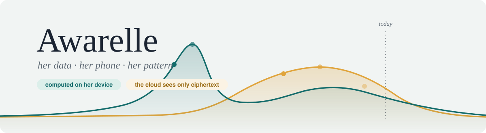
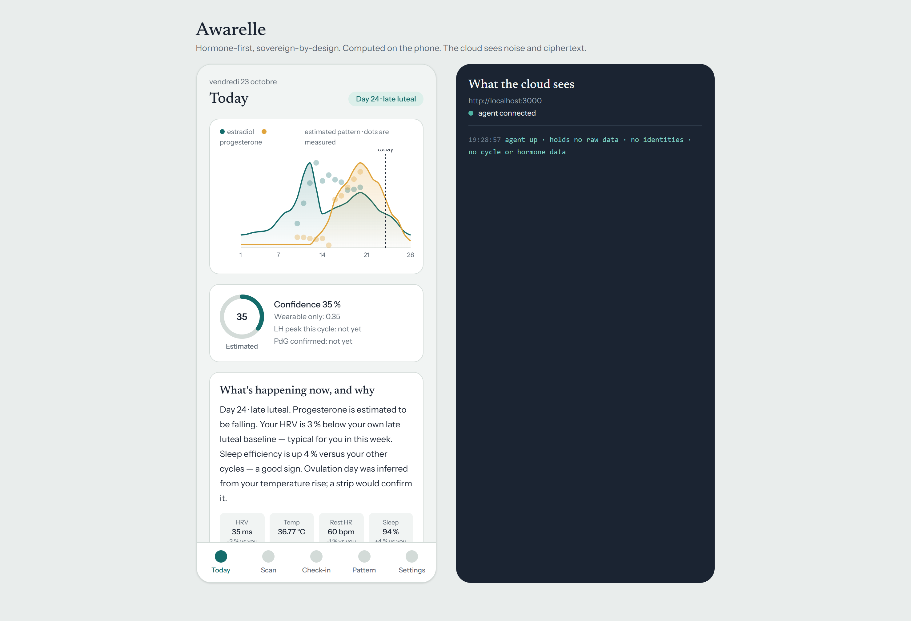
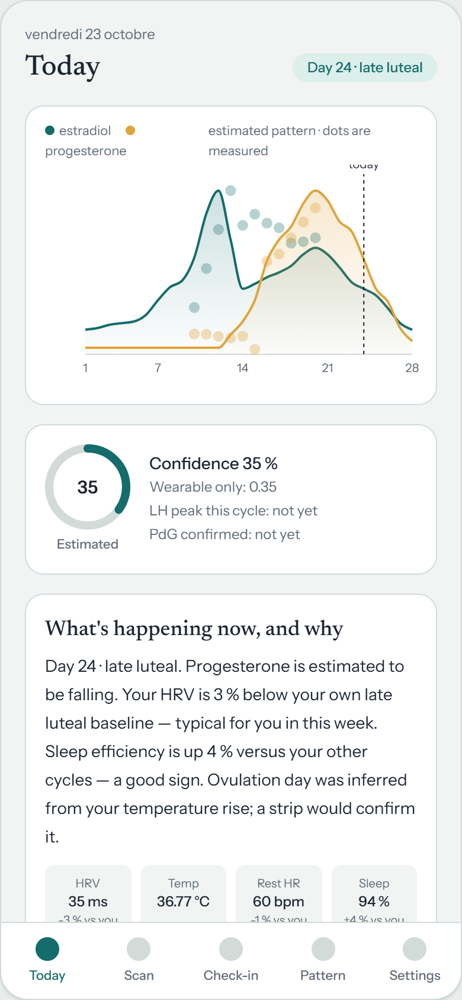
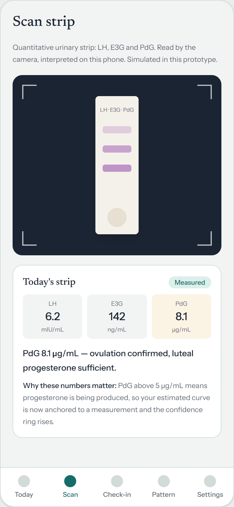
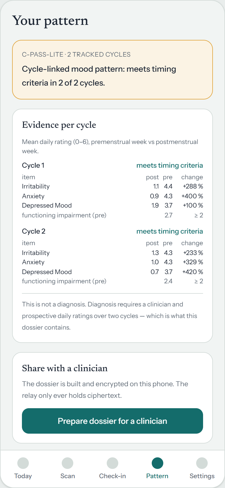
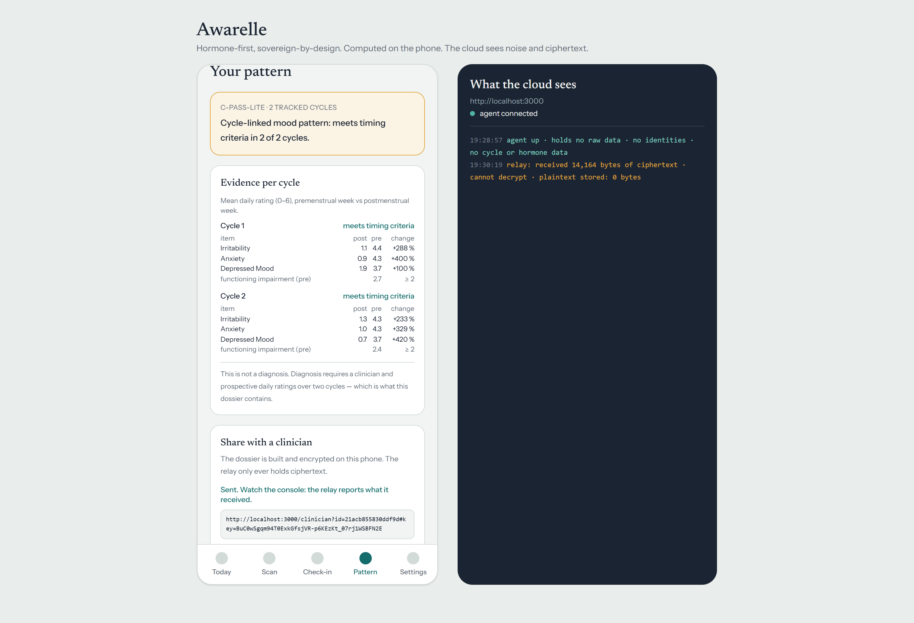
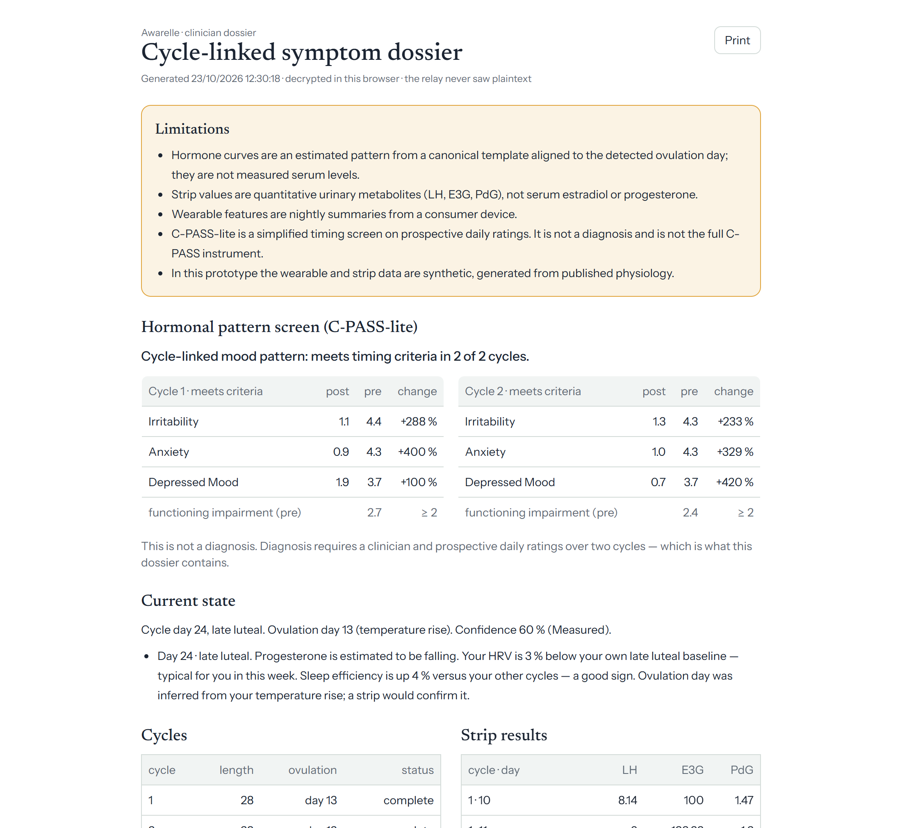
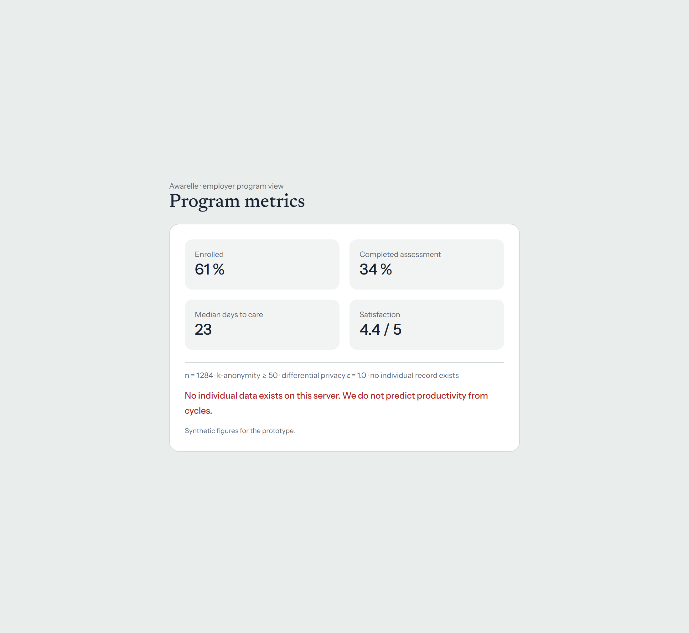

<div align="center">



<br/><br/>

[](#the-women-behind-it)
[](#the-women-behind-it)
[](#the-women-behind-it)

[](#sovereignty-is-the-architecture-not-a-promise)
[](#sovereignty-is-the-architecture-not-a-promise)
[](#sovereignty-is-the-architecture-not-a-promise)
[](#our-favorite-moment)

**Awarelle turns the wearable she already owns and a few hormone strips into an understanding
of her own hormonal pattern — and into the evidence a clinician needs — computed entirely on her phone.
The cloud sees noise and ciphertext. By design. Provably. Live on stage.**

</div>

---

## Why we built this

Women are told their symptoms are *"just hormones."*

It takes an average of **twelve years and six doctors** to get a PMDD diagnosis ([IAPMD](https://iapmd.org)). **Six to eleven years** for endometriosis. Up to **70 % of women with PCOS remain undiagnosed** worldwide ([WHO](https://www.who.int/news-room/fact-sheets/detail/polycystic-ovary-syndrome)). Not because the evidence doesn't exist — because **nobody collects it**. Diagnosis of a cycle-linked mood disorder requires prospective daily ratings across two full cycles. Almost no one arrives at a doctor's office holding that. So she is asked to come back in a year, or she is told it's stress, or she stops asking.

And the apps that *could* collect it? They ask her to hand her most intimate data to a server she will never see. In August 2025, a jury found Meta liable for intercepting period-tracker data from millions of women in the Flo Health case. A women's-health app whose data lives in a cloud is one subpoena, one acquisition, one "pixel integration" away from becoming evidence against the woman it claimed to serve.

We refused both failures at once. **Awarelle collects the evidence — and makes the surveillance architecturally impossible.** Not a privacy policy. An architecture: there is no individual record anywhere to leak, sell, or subpoena.

We built the first working prototype in one day, together, at **Build For Her** on **October 10, 2026** — a hackathon sponsored by **Ambarella**, featuring **RoamHer** and **The Glow Girl** social club, surrounded by women building for women. This repo is that prototype, exactly as we demoed it — plus everything we learned listening to the women around us.

## We asked women first

Before writing a line of the pitch, we wrote [a survey](https://mlyab.github.io/hormonal-health-survey/) and handed it to the women around us — at the hackathon and beyond. **19 women** have answered so far, and their answers shaped every decision in this codebase:

- **15 of 19** either never sought care for their symptoms, or sought it and *still have no answer*.
- Only **3 of 19** felt a doctor had fully taken them seriously.
- **17 of 19** see or suspect a link between their cycle and their mental health — yet **13 of 19** rate their understanding of their own hormones at **2 out of 5 or less**. The link is felt. The understanding is missing. That gap is Awarelle.
- **13 of 19** have already walked away from a health app **because of privacy**. The two things they wanted most from us: *understanding my own hormonal pattern* and *my data never leaving my phone*.
- **13 of 19 own no wearable** — which is why Awarelle never requires one (see [Who we didn't forget](#who-we-didnt-forget)).

> *"Hope would be to understand more about my specific body. Worry would be the data being sent to others."*
>
> *"That it eventually gets sold to a server for a quick buck."*
>
> *"Help women!!"*
>
> — survey respondents, October 2026

We're still listening. **If you have a cycle, [take the survey](https://mlyab.github.io/hormonal-health-survey/)** — it takes about three minutes and every answer steers what we build next.

## What Awarelle does

One screen, two sides, zero trust required. On the left, her phone. On the right, **"What the cloud sees"** — a live stream of the server's own logs, so the audience watches the cloud stay blind in real time.



**Today** reads the nights from the wearable she already owns — temperature, resting heart rate, HRV, sleep — and estimates where she is in her cycle: estradiol in teal, progesterone in amber, a confidence ring that is honest about being an estimate, and a plain-language card explaining *what's happening now, and why* against **her own baselines**, not population averages. The footer is our favorite sentence in the whole app: **"Bytes that left this device: 0."**

**Scan** anchors the estimate to a measurement: quantitative urinary hormone strips (LH, E3G, PdG) read by the camera. PdG above 5 µg/mL — ovulation confirmed, progesterone sufficient, and the confidence ring rises from *Estimated* to *Measured*. The console on the right logs nothing, because nothing left the phone.

**Check-in** is twenty seconds of sliders — irritability, anxiety, pain, functioning — the prospective daily ratings that diagnosis actually requires, collected gently, day after day, saved on the device.

| Today | Scan | Pattern |
|:---:|:---:|:---:|
|  |  |  |

**Pattern** is where it all becomes power. After two tracked cycles, our C-PASS-lite scorer compares her premenstrual week to her postmenstrual week, cycle by cycle, item by item — the timing logic of the validated C-PASS instrument, simplified and fully transparent. When the pattern meets timing criteria, it says so. And right underneath, always: ***"This is not a diagnosis."*** It's something better than a hot take: it's the two prospective cycles the DSM-5 requires, ready for the one person who can diagnose — her clinician.

**One tap encrypts the dossier on her phone** (AES-GCM 256, WebCrypto) and sends it through our relay. Watch the console: the server reports receiving *14,164 bytes of ciphertext · cannot decrypt · plaintext stored: 0 bytes*. The decryption key travels in the URL fragment — the part after `#` that browsers never send to any server. The relay physically cannot read what it carries.



**Her clinician opens the link** and the dossier decrypts *in their browser* — printable, honest, with its limitations box at the very top before any data:

| What her clinician sees | What her employer sees |
|:---:|:---:|
|  |  |

**And the employer who pays for the program?** Aggregates. Only aggregates. n = 1,284 · k-anonymity ≥ 50 · differential privacy ε = 1.0 — and a sentence we wrote in red on purpose: **"No individual data exists on this server. We do not predict productivity from cycles."** We never will. Employers who pay cannot see.

### Our favorite moment

Mid-pitch, we stopped the cloud agent. Killed it, live, from the dashboard. **The app didn't blink** — curves, scan, check-in, pattern, all still working, ledger still reading zero. Then we restarted the cloud and it had learned nothing about her, because there was never anything for it to learn. That's not a feature flag. That's the architecture working.

## Sovereignty is the architecture, not a promise

We thought about this part the hardest, because this is the part women told us they'd been burned on. Every claim below is enforced by code in this repo, not by a terms-of-service page:

| What we promise her | How the code keeps the promise |
|---|---|
| Nothing readable ever leaves her phone | `fetch` is wrapped once at startup; **every outgoing byte is counted and itemized** in a ledger she can read in Settings — [`client/src/state/ledger.ts`](client/src/state/ledger.ts) |
| The relay cannot read her dossier | Encrypted on device with AES-GCM 256; the key lives in the URL fragment, which browsers never transmit — [`client/src/crypto/dossier.ts`](client/src/crypto/dossier.ts) |
| The population model cannot memorize her | Updates are clipped to unit norm and Gaussian-noised (ε ≈ 1.0) **before** leaving the phone — and contribution is **opt-in, off by default** — [`client/src/model/dp.ts`](client/src/model/dp.ts) |
| Employers see a cohort, never a woman | The server only ever serves aggregates with k ≥ 50 — [`server/index.ts`](server/index.ts) |
| The cloud is optional | Offline-first PWA: reload it in airplane mode and everything still works |
| You don't have to trust us | The **"What the cloud sees"** console streams the server's own logs beside the phone, all demo long |
| Her estimates are never dressed up as measurements | The confidence ring says *Estimated* until a strip says *Measured*; every curve is labeled an estimated pattern |
| She can leave, completely | Settings → **Delete everything**: clears the device, and there is no server copy to beg back |

## Honest about what's real

We said this on stage and we'll say it here, because an audience that can't tell what's mocked can't trust what isn't:

- **Synthetic (for the demo):** the wearable nights and strip values — generated from published cycle physiology, seeded, deterministic ([`client/src/data/synth.ts`](client/src/data/synth.ts)); the camera scan animation; the employer metrics (labeled synthetic on the page itself); the phase model is a simplified, transparent estimator — every rule of it is readable in [`client/src/model/phase.ts`](client/src/model/phase.ts). No LLM calls anywhere: every explanation is templated, deterministic, and honest about its uncertainty.
- **Real (running code):** the AES-GCM encryption, the key-in-fragment relay, the differential-privacy clipping and noise, the byte ledger, the SSE console, the offline PWA, the C-PASS-lite timing math.

**Awarelle is a hackathon prototype, not a medical device.** It diagnoses nothing. It exists to get her — faster — to the person who can.

## Who we didn't forget

Designing *for her* means asking *which her*, and the survey kept us honest:

- **She owns no wearable** (13 of our 19 respondents): Awarelle runs on strips and the twenty-second check-in alone — the physiology panel hides, the evidence still builds.
- **She's on hormonal contraception:** a symptom-only mode with a straight answer on screen — there is no ovulatory cycle to estimate, so we don't pretend to estimate one.
- **Her cycles are irregular:** calibration takes longer, and the app says so instead of faking confidence.
- **Her situation is unsafe:** there is no server copy to subpoena and no account to compromise; the residual risk is her own phone, and we tell her that plainly instead of pretending the risk is zero.

## Run it yourself

```bash
git clone https://github.com/mlyab/awarelle.git
cd awarelle
npm ci
npm run build
npm start          # → http://localhost:3000
```

Or with Docker:

```bash
docker build -t awarelle .
docker run -p 3000:3000 awarelle
```

Open `http://localhost:3000`, and keep an eye on the right-hand console — that's the whole point. Then try it: scan a strip, send a dossier, open the clinician link in a new tab, visit `/employer`. Then turn your Wi-Fi off and watch nothing break.

Stack, kept deliberately boring: **React + TypeScript + Vite + Tailwind + Recharts** on the phone side, **Node 20 + Express** as the blind cloud, one Dockerfile, no database — because the most trustworthy place to store a woman's data is the one we never built.

## Where this goes next

- A **Phase I cohort with a cycle-science lab**, using the full validated instruments (DRSP, C-PASS) — run **federated**, so the lab never holds raw data either.
- A **quantitative strip partner** (think Oova) to replace synthetic strip values with her real ones.
- A **small women's-health ring partner** for the nights.
- More listening: the [survey](https://mlyab.github.io/hormonal-health-survey/) stays open, and it keeps steering.

## The women behind it

Built with care, fury in one day by:

- **Malya Aboun** — [GitHub](https://github.com/mlyab) · [LinkedIn](https://www.linkedin.com/in/malya-aboun/)
- **Emma Châtaignier** · [LinkedIn](https://www.linkedin.com/in/emma-chataigner/)
- **Tamara** · [LinkedIn](https://www.linkedin.com/in/tamarandi/)

With gratitude to **Build For Her** for the room full of builders, to **Ambarella** for sponsoring it, to **RoamHer** and **The Glow Girl** social club for the energy — and most of all to the **19 women (and counting)** who told us what they actually needed. We heard you. The ledger says zero.

## License

© 2026 Malya Aboun, Emma Châtaignier & Tamara N. — **all rights reserved.** We publish this code so you can read it, run it, and hold our privacy claims to account — not so it can be copied. No reuse, redistribution, or derivative work without our written permission. Details in [LICENSE](LICENSE).

---

<div align="center">

*Her symptoms were never "just hormones." Now there's a dossier to prove it —*
*and it never left her phone.*

**[Take the survey](https://mlyab.github.io/hormonal-health-survey/) · [Run the demo](#run-it-yourself) · [Read the privacy architecture](#sovereignty-is-the-architecture-not-a-promise)**

</div>
